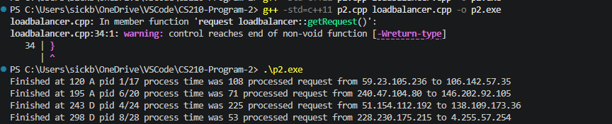

# C++ Load Balancer Simulation

A **discrete-time request-scheduling simulation** built as part of **CS 210 coursework at San Diego State University**. The program generates requests, holds pending work in a C++ container, and models five servers processing requests over simulated time.

> **Coursework attribution:** The professor supplied starter code; I completed or modified parts of the assignment. This repository documents the resulting coursework, its scheduling configurations, and my recorded output. The servers are simulated objects—there is no real network traffic or web hosting.



## At a glance

| | |
| --- | --- |
| **Language** | C++ (C++11) |
| **Concepts** | Queues, stacks, priority queues, custom comparators, classes, simulation |
| **Server model** | Five simulated servers (A–E) |
| **Current scheduling policy** | Max-priority queue based on request/process ID (`MaxPID`) |
| **Execution** | Command-line program; simulated time and randomly generated requests |

## How it works

1. `createRandomRequest()` constructs a request with a source and destination address string, a unique increasing process ID, and a randomly generated processing time from **0 to 499**.
2. The load balancer begins with **10 queued requests**. Five server objects receive initial requests.
3. During the simulation, the program checks a server selected by `currentTime % 5`. When that server's current request has finished, it logs the result and obtains another queued request.
4. On roughly **one in ten simulation-loop iterations**, the program generates an additional request. The main loop continues while the simulated clock is below **10,000**.
5. Console output records the completion time, server name, process ID, queue size at the check, request processing time, and source/destination strings.

**Example output format:**

```text
Finished at <time> <server> pid <id>/<queue-size> process time was <ticks> processed request from <source> to <destination>
```

Because requests and processing times are randomized, output differs between runs. The dotted address strings are simulated data, not actual network connections.

## Scheduling / data structures

The source includes definitions and coursework exploration of several request-ordering approaches:

| Approach | Where it appears | Ordering idea |
| --- | --- | --- |
| FIFO queue | Commented alternative in `loadbalancer.h` and `loadbalancer.cpp` | Earliest queued request first |
| Stack | Commented alternative in `loadbalancer.h` | Most recently added request first |
| Max-priority by processing time | `MaxProcessTime` comparator in `request.h` | Larger processing time first |
| Min-priority by processing time | `MinProcessTime` comparator in `request.h` | Smaller processing time first |
| **Max-priority by process ID** | **Active** `MaxPID` comparator in `loadbalancer.h` | Higher process IDs first |

The different policies are **not selectable from the running program**. Exploring a different container/policy requires changing the relevant source declarations and, for FIFO, changing retrieval from `.top()` to `.front()`.

The current code prioritizes *requests* using `MaxPID`; it does **not** measure live CPU usage or automatically assign work to the least-loaded physical server.

## Build and run

**Requirements:** A C++11-capable compiler such as `g++`. No third-party libraries are required.

From the repository directory:

```bash
g++ -std=c++11 p2.cpp loadbalancer.cpp -o loadbalancer
```

Then run:

**Windows PowerShell:**

```powershell
.\loadbalancer.exe
```

**macOS / Linux:**

```bash
./loadbalancer
```

`p2.cpp` directly includes `webserver.cpp`, so do **not** compile `webserver.cpp` a second time in the command above.

## Repository guide

| File | Purpose |
| --- | --- |
| [`p2.cpp`](p2.cpp) | Main simulation, request generator, five-server setup, console logging |
| [`request.h`](request.h) | Request data structure and priority comparison rules |
| [`loadbalancer.h`](loadbalancer.h), [`loadbalancer.cpp`](loadbalancer.cpp) | Pending-request container and simulated clock |
| [`webserver.cpp`](webserver.cpp) | Simulated server object and request-completion check |
| [`makefile`](makefile) | Original build instructions; references an absent `p3.cpp` |
| [`ComplexityAnalysis.png`](ComplexityAnalysis.png) | Submitted written comparison of queue, stack, and priority-queue behavior |

The repository also retains screenshots, a compiled `p2.exe`, and `desktop.ini` from the original coursework upload. They are not required for understanding the source; no existing files were deleted in this documentation-only update.

## Output and assignment evidence

The repository includes screenshots of command-line runs. These show simulation output, not automated tests or measured real-world server performance.

- [Sample compilation and run](Screenshot1.png)
- [Additional output, beginning of a run](Screenshot3.png)
- [Extended console output](Screenshot5.png)
- [More recorded output](Screenshot8.png)
- [Written data-structure comparison](ComplexityAnalysis.png)

## Limitations and possible improvements

- **Empty queue:** `loadbalancer::getRequest()` has no return value when the queue is empty; a future implementation should handle that case explicitly.

## Project context

This repository reflects a **course assignment using instructor-provided starter code that I completed or modified**. I preserved the submitted implementation while making the project easier to understand, inspect, and run. The screenshots and analysis were part of my coursework documentation.
